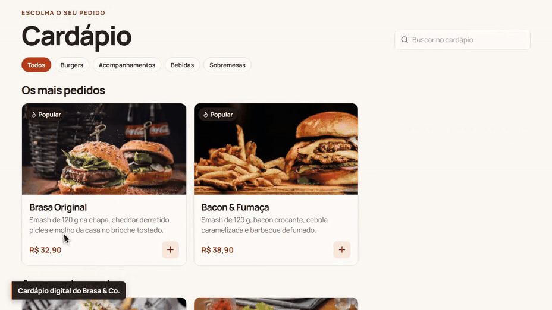

# MenuVerse

Cardápio digital, pedidos online e gestão de restaurantes. O Brasa & Co. é a hamburgueria fictícia usada para demonstrar o fluxo completo.

## Demonstração da Plataforma



[Assistir à demonstração completa (MP4)](docs/media/demo.mp4)

## Executar localmente

Requisitos: Node.js 24 ou superior e npm. O modo demonstrativo local usa SQLite no servidor. Para esse modo, nenhum cadastro ou serviço externo é necessário.

```sh
npm ci
npm run dev
```

Abra [localhost:3000](http://localhost:3000). Em **Experimentar demonstração**, personalize um item do cardápio, adicione-o ao carrinho e envie um pedido com dados fictícios. Abra **Painel** ou **Cozinha** em outra aba do mesmo navegador, localize o pedido e avance o status. A página de acompanhamento atualiza automaticamente.

Se o navegador mostrar “conexão recusada”, inicie `npm run dev` na pasta do projeto e mantenha o terminal aberto durante o uso. Abra o endereço exibido pelo Next.js e acrescente `/demo` para entrar diretamente no cardápio. Use o mesmo endereço nas abas do cliente e da cozinha para compartilhar a sessão.

Cada navegador recebe uma sessão demonstrativa privada por sete dias. As abas compartilham os pedidos da sessão, e cada aba mantém seu carrinho durante a navegação. Use uma janela anônima para começar com os dados iniciais.

| Rota                | O que oferece                                                             |
| ------------------- | ------------------------------------------------------------------------- |
| /                   | Apresentação do MenuVerse                                                 |
| /cardapio           | Cardápio do Brasa & Co., personalização e checkout demonstrativo          |
| /painel             | Indicadores, pedidos, produtos, categorias e configurações demonstrativas |
| /cozinha            | Fila demonstrativa de preparo                                             |
| /pedido/{id}        | Acompanhamento do pedido da sessão                                        |
| /equipe             | Login e seleção do restaurante no ambiente de operação                    |
| /restaurante/{slug} | Cardápio de um restaurante publicado na operação                          |

## Verificações

```sh
npm run format:check
npm run lint
npm run typecheck
npm test
npx playwright install chromium
npm run test:e2e
```

Vitest cobre preços, regras de personalização, permissões e transações SQL. Playwright gera o build de produção e percorre a experiência demonstrativa em Chromium com configurações de desktop e celular. O [guia de provisionamento](docs/deploy.md#teste-de-integração-local) descreve o teste adicional com Supabase Auth e Postgres. GitHub Actions executa os checks a cada pull request e push em main.

## Supabase e Vercel

Consulte o [guia de provisionamento](docs/deploy.md), a [arquitetura e modelagem](docs/arquitetura.md) e os [contratos HTTP](docs/api.md). O checkout registra um pedido sem pagamento integrado.

## Créditos

Developed by [oEnzoRibas](https://github.com/oEnzoRibas).

As fotografias gastronômicas são do Unsplash e os arquivos de origem estão em [Demonstração e créditos de mídia](docs/midia.md). Veja a proposta de licença do código em [LICENSE](LICENSE).
