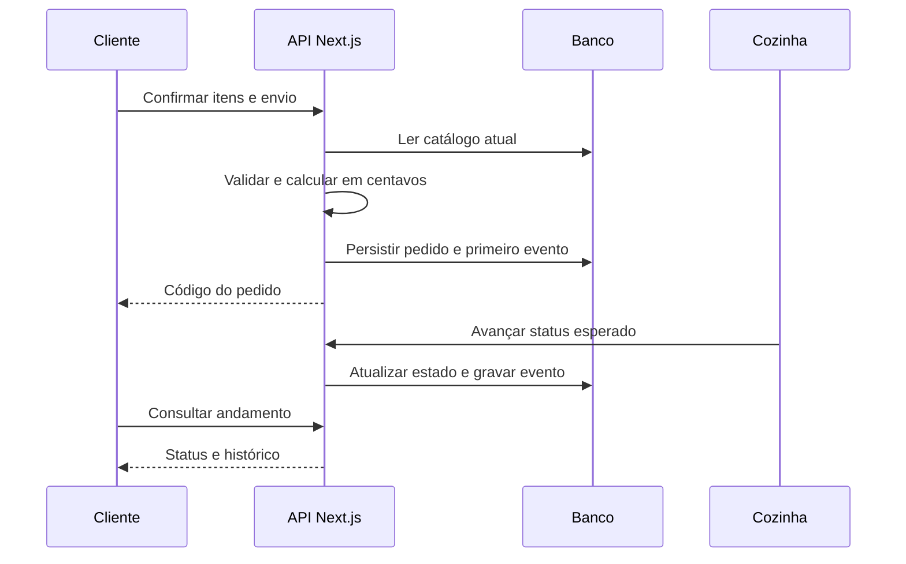
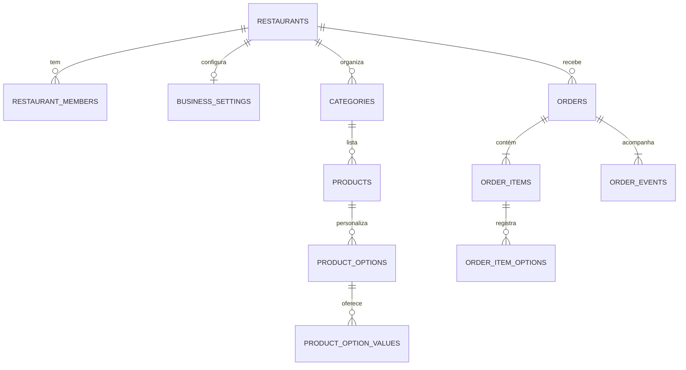

# Arquitetura

Next.js App Router entrega a landing page, cardápio, operações e acompanhamento. Componentes interativos usam Zustand, Radix, Motion, React Hook Form e Zod. O servidor recebe identificadores e personalizações, valida os dados e resolve preços pelo catálogo. O valor mostrado ao cliente serve para detectar alterações durante o checkout. Valores monetários usam centavos inteiros.

## Demonstração

Uma sessão recebe catálogo e pedidos sintéticos no primeiro acesso. O cookie HttpOnly identifica a sessão com um token aleatório. O servidor guarda o estado em SQLite local ou em Postgres Supabase na hospedagem, com a mesma interface. A atualização usa controle otimista por versão para evitar sobrescrita entre abas. A confirmação aceita um identificador de tentativa para que um reenvio retorne o mesmo pedido. Navegadores com sessões distintas não compartilham catálogo, pedidos ou histórico.

## Operação

Supabase Auth verifica a identidade da equipe. A associação a um restaurante autoriza leitura e operações específicas. RLS e chaves compostas filtram por restaurante e impedem relações entre registros de restaurantes diferentes. A cozinha avança pedidos. A administração também gerencia catálogo e atendimento e consulta endereços. O cliente acompanha apenas os campos públicos de seu pedido mediante cookie de acompanhamento. O banco guarda somente o hash da credencial.

O checkout usa uma versão consistente do catálogo. A função transacional confere essa versão com bloqueio na linha do restaurante antes de gravar pedido, itens, complementos e evento inicial. Uma alteração concorrente do catálogo exige nova revisão do cliente. A transição de status compara o estado anterior e grava a mudança e o histórico na mesma transação.

O painel e a cozinha sincronizam a cada três segundos. O acompanhamento consulta o status a cada 2,5 segundos. A interface mostra falhas de sincronização e retoma as consultas.

## Modelagem da operação

Os itens guardam nome, preço unitário e personalizações confirmadas como fotografia do pedido, mesmo após uma edição do catálogo. As migrações em `supabase/migrations` são a fonte das constraints, dos índices e das políticas.
